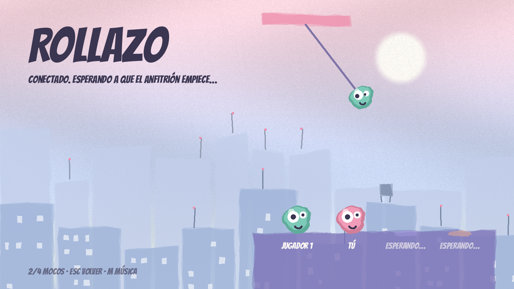

# Rollazo: manual para jugar con los amigos

Rollazo es una carrera de hasta **4 mocos** que se columpian con papel higiénico por los
tejados de una ciudad. Puedes cortar el papel de los demás, agarrarte a ellos y chocar.
Cada ronda es un mapa nuevo y gana quien sume más puntos.

Para jugar online, un PC hace de **anfitrión** (el que crea la partida) y los demás se
**unen** a él. Como no estamos en la misma casa, usamos **Tailscale**: crea una red privada
entre nuestros PCs por internet. Es gratis y no hace falta tocar el router.

---

## 1. Preparación (solo la primera vez, cada uno)

1. **Tailscale.** Descárgalo en https://tailscale.com/download, instálalo y entra con tu cuenta
   de Google, Microsoft o GitHub.
2. **Estar en la misma red.** El anfitrión entra en https://login.tailscale.com/admin/users,
   pulsa **Invite users** y manda el enlace a cada amigo. Cada amigo lo abre y acepta.
3. **El juego.** Copia `Rollazo.exe` en tu PC (te lo pasa el anfitrión por Drive, WeTransfer…).
   No se instala: se abre con doble clic.
   - Si Windows avisa de que es una app desconocida: **Más información → Ejecutar de todas formas**.
4. **Firewall (solo el anfitrión).** La primera vez que pulse **Crear partida**, Windows
   pregunta si permite el acceso: marca **Redes privadas** y pulsa **Permitir**.

---

## 2. El menú

| Elemento | Para qué sirve |
|---|---|
| **Practicar solo** | Juegas tú solo en un mapa aleatorio, para aprender. **R** repite el mismo mapa. |
| **Crear partida** | Te conviertes en el **anfitrión**: los demás se unen a ti. |
| **Casilla de IP** (pone `127.0.0.1`) | Aquí escribe el amigo la IP del anfitrión. Haz clic en ella, borra lo que hay y pega la IP. |
| **Unirse** | Te conecta a la IP que hay en la casilla. |
| **Azotea de la derecha** | Los 4 huecos de la partida. Cuando alguien entra, su moco cae de un salto con su color. |
| **Abajo** | Cuántos mocos hay (por ejemplo `2/4 MOCOS`) y los atajos de teclado. |

> `127.0.0.1` significa "este mismo PC". Solo sirve para probar con dos ventanas en tu
> ordenador. Para jugar con amigos hay que poner la IP de Tailscale del anfitrión.

---

## 3. Si eres el anfitrión

1. **Abre Tailscale** (icono junto al reloj de Windows, abajo a la derecha) y comprueba que
   está conectado.
2. **Copia tu IP.** En el menú de Tailscale, tu PC aparece con una IP que empieza por `100.`
   (por ejemplo `100.101.7.42`). Haz clic en ella y se copia.
3. **Pásala** por el grupo de WhatsApp o Discord.
4. **Abre Rollazo y pulsa Crear partida.** Verás esto:

   

   - Tu moco aparece en la azotea con **TÚ** debajo.
   - Cada amigo que se une cae en un hueco libre (**JUGADOR 2**, **JUGADOR 3**…).
   - Las opciones de practicar, crear y unirse desaparecen mientras la partida está abierta.
5. **Cuando estéis todos, pulsa ¡EMPEZAR CARRERA!** Solo lo ve el anfitrión.

> Cuando la carrera ya ha empezado no entra nadie más. Si alguien llega tarde, salid al menú
> (**Esc**), crea otra partida y que se unan todos otra vez.

---

## 4. Si eres un amigo

1. Comprueba que **Tailscale está conectado**: el icono no debe estar tachado.
2. Abre Rollazo.
3. **Haz clic en la casilla de IP**, borra `127.0.0.1` y **pega la IP del anfitrión**
   (la que empieza por `100.`).
4. Pulsa **Unirse**. Al conectar verás tu moco en la azotea con **TÚ** y el mensaje
   *"Conectado. Esperando a que el anfitrión empiece…"*:

   

5. Espera a que el anfitrión pulse **¡Empezar carrera!**

---

## 5. Durante la carrera

- **Arriba a la izquierda:** tu tiempo.
- **Arriba en el centro, en rosa:** la **cuenta atrás**. Aparece cuando llega el primero:
  los demás tenéis **20 segundos**, y en los 5 últimos el número late.
- **Arriba a la derecha:** **MENÚ (Esc)** para salir al menú.
- **Abajo:** la ayuda de controles. Desaparece la primera vez que te enganchas.
- **Mira de puntos:** al apuntar, si el papel va a engancharse ves una línea de puntos de tu
  color. Si sale un punto gris, no llega. Se quita y se pone con **T**.
- **Puntos de control:** las plataformas lisas de descanso. Si te caes, vuelves al último por el
  que pasaste.
- **La meta:** la bandera ciruela al final del todo.

### Controles

| Acción | Tecla |
|---|---|
| Lanzar el papel y columpiarte | **mantener** clic izquierdo |
| Soltar con impulso | soltar el clic (impulso extra si llevabas un rato colgado) |
| Recoger / soltar papel | W / S |
| Moverte | A / D |
| Saltar | Espacio |
| Cortar el papel de otro | clic derecho cerca de su papel |
| Agarrarte a otro / soltarte | E (con Espacio también te sueltas) |
| Quitar / poner la mira de puntos | T |
| Silenciar la música | M |
| Volver al menú | Esc |
| Repetir el mapa (solo al practicar) | R |

**Trucos:**
- El papel se gasta. Si tiembla y se vuelve rosa, está a punto de romperse.
- Si te agarras a otro, le pesas: cae más rápido.
- Chocar fuerte contra otro moco lo lanza por los aires.

---

## 6. Rondas y puntos

- Puntos por orden de llegada: **10, 6, 3 y 1**. Quien no llega en los 20 segundos se queda
  sin puntos.
- Al terminar la ronda salen **5 segundos de resultados**, con el color de cada moco y sus
  puntos totales. Va primero quien lleva más puntos.
- Después empieza otra ronda con **un mapa nuevo**. Los puntos se van sumando.

---

## 7. Si algo falla

| Qué pasa | Qué hacer |
|---|---|
| **"No se pudo conectar"** | Comprobad que los dos tenéis Tailscale encendido y que la IP es la `100.x` del anfitrión, no la de vuestro wifi. Podéis probar `ping 100.x.y.z` en una terminal. |
| **"No se pudo conectar" con todo bien** | Puede que ya haya 4 jugadores, o que la carrera haya empezado. Esperad a la siguiente partida. |
| **"El anfitrión se ha ido"** | El anfitrión cerró el juego o salió al menú. Que cree otra partida y os unís otra vez. |
| **"No se pudo crear (¿puerto ocupado?)"** | Ya hay otro Rollazo abierto haciendo de anfitrión en ese PC. Cierra las otras ventanas. |
| **El firewall bloqueó el juego** | En Windows, busca *"Permitir una aplicación a través del Firewall"* y marca Rollazo en **Privada**. |
| **El columpio va con retraso** | Normal si la conexión es mala. Apuntadlo y contádmelo: se puede mejorar. |

### Probar en un solo PC (sin amigos)

Abre **dos** `Rollazo.exe`. En uno pulsa **Crear partida** y en el otro deja `127.0.0.1` y pulsa
**Unirse**. Manejas un moco en cada ventana.
