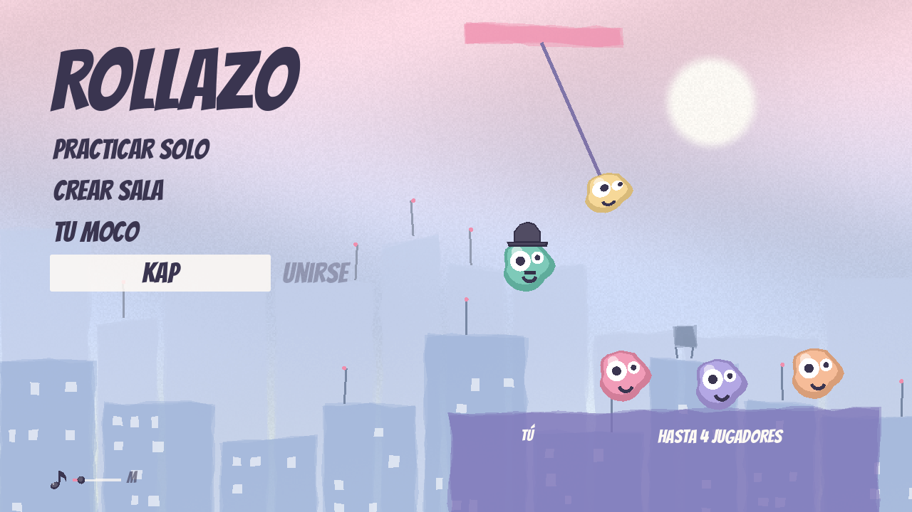
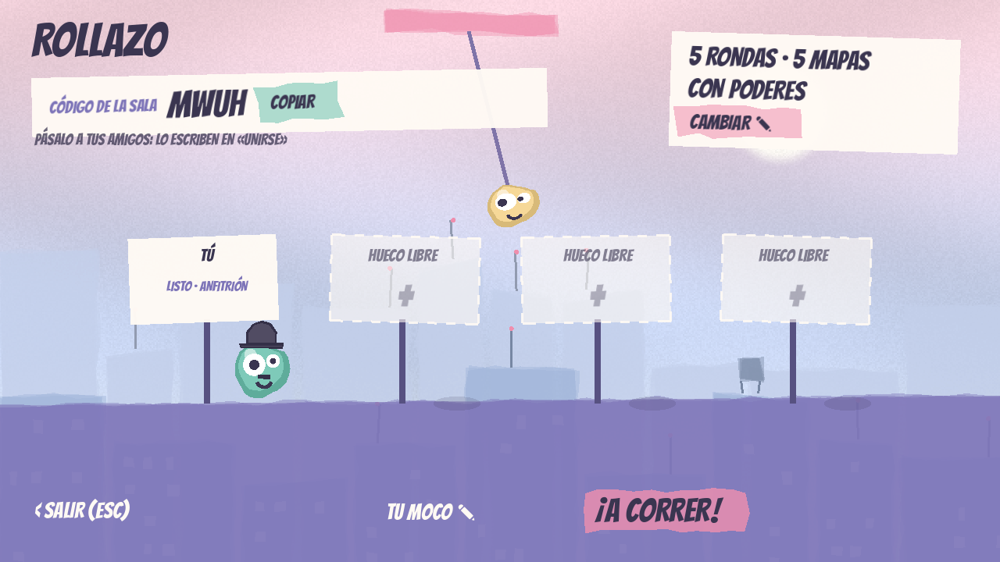
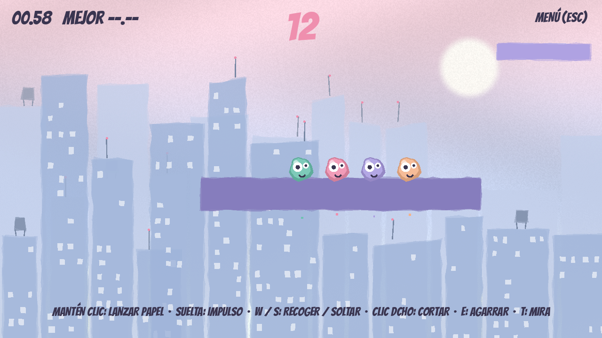
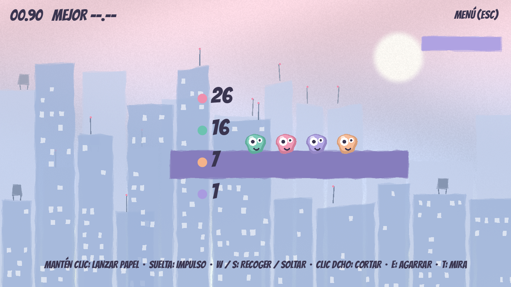

# Rollazo: manual para jugar con los amigos

Rollazo es una carrera de hasta **4 mocos** que se columpian con papel higiénico por los
tejados de una ciudad. Puedes cortar el papel de los demás, agarrarte a ellos y chocar.
Cada ronda es un mapa nuevo y gana quien sume más puntos.

Para jugar online, uno **crea una sala** y le sale un **código de 4 letras**. Los demás
escriben ese código y entran. No hace falta instalar nada más ni saber ninguna IP.

---

## 1. Preparación (solo la primera vez, cada uno)

1. **Descarga el zip** de la última versión en https://github.com/olwpad/Rollazo/releases
   (o te lo pasa un amigo).
2. **Descomprímelo** en una carpeta. Dentro hay `Rollazo.exe` y un `.dll`: tienen que estar
   **juntos** en la misma carpeta, si no el online no funciona.
3. Ábrelo con doble clic. Si Windows avisa de que es una app desconocida:
   **Más información → Ejecutar de todas formas**.

---

## 2. El menú

| Elemento | Para qué sirve |
|---|---|
| **Practicar solo** | Juegas tú solo en un mapa aleatorio, para aprender. **R** repite el mismo mapa. |
| **Crear sala** | Te conviertes en el **anfitrión** y te sale el código de la sala. |
| **Tu moco** | Cambias tu ropa, tu color y tu nombre. |
| **Casilla del código** | Aquí escribe el amigo las 4 letras de la sala. Recuerda el último código. |
| **Unirse** | Se enciende al escribir las 4 letras. Te mete en esa sala. |

---

## 3. Si eres el anfitrión

1. Pulsa **Crear sala**. En un momento sale arriba el **código de la sala** (por ejemplo `MWUH`):

   

2. Pulsa **COPIAR** y pásalo por el grupo de WhatsApp o Discord.
3. Cada amigo que entra aparece en un cartel de la azotea.
4. **Cuando estéis todos, pulsa ¡A CORRER!** Solo lo ve el anfitrión.

> Cuando la carrera ya ha empezado no entra nadie más. Si alguien llega tarde, salid al menú
> (**Esc**), crea otra sala y que entren todos con el código nuevo.

---

## 4. Si eres un amigo

1. Abre Rollazo.
2. Escribe en la casilla las **4 letras** que te ha pasado el anfitrión.
3. Pulsa **Unirse**. Al conectar aparece tu moco en la azotea.
4. Espera a que el anfitrión pulse **¡A CORRER!**

---

## 5. Durante la carrera

- **Arriba a la izquierda:** tu tiempo.
- **Arriba en el centro, en rosa:** la **cuenta atrás**. Aparece cuando llega el primero:
  los demás tenéis **20 segundos**, y en los 5 últimos el número late.
- **Arriba a la derecha:** **MENÚ (Esc)** para salir al menú.
- **Abajo:** la ayuda de controles. Desaparece la primera vez que te enganchas.
- **Mira de puntos:** al apuntar, si el papel va a engancharse ves una línea de puntos de tu
  color. Si sale un punto gris, no llega. Se quita y se pone con **T**.
- **Puntos de control:** las plataformas lisas de descanso. Si te caes, vuelves al último por el
  que pasaste.
- **La meta:** la bandera ciruela al final del todo.

### Controles

| Acción | Tecla |
|---|---|
| Lanzar el papel y columpiarte | **mantener** clic izquierdo |
| Soltar con impulso | soltar el clic (impulso extra si llevabas un rato colgado) |
| Recoger / soltar papel | W / S |
| Moverte | A / D |
| Saltar | Espacio |
| Cortar el papel de otro | clic derecho cerca de su papel |
| Agarrarte a otro / soltarte | E (con Espacio también te sueltas) |
| Quitar / poner la mira de puntos | T |
| Silenciar la música | M |
| Volver al menú | Esc |
| Repetir el mapa (solo al practicar) | R |

**Trucos:**
- El papel se gasta. Si tiembla y se vuelve rosa, está a punto de romperse.
- Si te agarras a otro, le pesas: cae más rápido.
- Chocar fuerte contra otro moco lo lanza por los aires.

---

## 6. Rondas y puntos

- Puntos por orden de llegada: **10, 6, 3 y 1**. Quien no llega en los 20 segundos se queda
  sin puntos.
- Al terminar la ronda salen **5 segundos de resultados**, con el color de cada moco y sus
  puntos totales. Va primero quien lleva más puntos.
- Después empieza otra ronda con **un mapa nuevo**. Los puntos se van sumando.

---

## 7. Si algo falla

| Qué pasa | Qué hacer |
|---|---|
| **"ESA SALA NO EXISTE"** | Revisa las 4 letras. Si el anfitrión salió al menú, la sala se cierra: que cree otra. |
| **"LA SALA ESTÁ LLENA"** | Ya hay 4 jugadores. |
| **"NO HAY CONEXIÓN CON EL SERVIDOR"** | Revisa tu internet. Si a todos os pasa, el servidor de salas está caído: probad más tarde. |
| **"NO SE PUDO CONECTAR CON EL ANFITRIÓN"** | Vuestros routers no se dejan hablar directamente (pasa en algunas redes de móvil o de empresa). Probad con el wifi de casa y contádmelo. |
| **"El anfitrión se ha ido"** | El anfitrión cerró el juego o salió al menú. Que cree otra sala y entráis otra vez. |
| **El online no hace nada** | Comprueba que el `.dll` está en la misma carpeta que `Rollazo.exe`. |
| **El columpio va con retraso** | Normal si la conexión es mala. Apuntadlo y contádmelo: se puede mejorar. |

### Probar en un solo PC (sin amigos)

Abre **dos** `Rollazo.exe`. En uno pulsa **Crear sala** y en el otro escribe el código y pulsa
**Unirse**. Manejas un moco en cada ventana.
